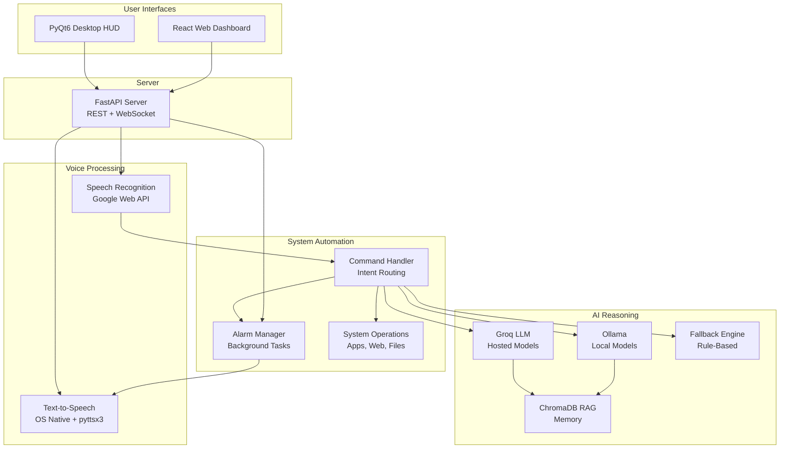

# Nova — Voice Assistant Platform

[](https://opensource.org/licenses/MIT)
[](https://www.python.org/downloads/)
[](https://fastapi.tiangolo.com/)
[](https://react.dev/)
[](https://developer.mozilla.org/en-US/docs/Web/API/WebSocket)

Nova is an open-source, enterprise-grade voice assistant platform offering dual-mode operation (desktop and web) with advanced AI reasoning capabilities. It combines speech recognition, text-to-speech synthesis, and large language models to deliver a comprehensive voice-first automation and interaction system.

## 📋 Table of Contents

- [Features](#features)
- [Architecture](#architecture)
- [Installation](#installation)
- [Configuration](#configuration)
- [API Reference](#api-reference)
- [Usage](#usage)
- [Tech Stack](#tech-stack)
- [Project Structure](#project-structure)
- [Contributing](#contributing)
- [License](#license)

## ✨ Features

| Category | Capability | Details |
|----------|-----------|---------|
| **Voice Processing** | Speech Recognition | Google Web Speech API with multi-language support |
| | Text-to-Speech | Native OS integration (Windows PowerShell, macOS `say`, Linux `espeak`) |
| **Intelligence** | LLM Integration | Groq API (hosted) and Ollama (local) support |
| | RAG Memory | ChromaDB with sentence-transformers embeddings |
| | Fallback Engine | Rule-based responses for common queries |
| **Automation** | System Control | App launching, screenshot capture, volume control |
| | Web Access | Search integration and browser automation |
| **Monitoring** | Alarms & Timers | Background service with real-time tracking |
| | System Stats | CPU, RAM, and battery monitoring |
| **Interfaces** | Desktop UI | PyQt6 holographic HUD with waveform visualization |
| | Web Dashboard | React with real-time WebSocket updates |
| **Productivity** | Task Management | To-do lists with voice-based note-taking |
| | Conversation Logging | Timestamped conversation history and persistence |

## 🏗️ Architecture



## 🛠️ Installation

### Prerequisites
- **Python 3.10+**
- **Node.js 16+** (for web UI)
- **Git**

### Quick Start

```bash
# 1. Clone repository
git clone https://github.com/yourusername/nova-ai.git
cd nova-ai

# 2. Create virtual environment
python -m venv venv
source venv/bin/activate  # On Windows: venv\Scripts\activate

# 3. Install Python dependencies
pip install -r requirements.txt

# 4. Copy and configure
cp config.sample.json config.json
# Edit config.json with your API keys and preferences

# 5. (Optional) Build web interface
cd web_ui
npm install
npm run build
cd ..
```

### Running Nova

**Desktop Mode (PyQt6 GUI):**
```bash
python main.py
```

**Web Server Mode (FastAPI + React):**
```bash
python server.py
# Navigate to http://localhost:8000
```

**Terminal Mode (no GUI):**
```bash
python main.py --no-gui --text
```

## ⚙️ Configuration

Create `config.json` from `config.sample.json`. All fields are optional with sensible defaults.

### Core Settings

| Field | Type | Default | Description |
|-------|------|---------|-------------|
| `assistant_name` | string | `"Nova"` | Name used in responses |
| `user_name` | string | `"Sir"` | User's preferred title |
| `wake_word` | string | `"nova"` | Activation keyword for voice mode |

### Voice Settings

| Field | Type | Default | Description |
|-------|------|---------|-------------|
| `voice_rate` | integer | `165` | TTS speech rate (WPM) |
| `voice_volume` | float | `1.0` | TTS volume (0.0 to 1.0) |
| `voice_gender` | string | `"male"` | TTS voice preference (male/female) |

### LLM Configuration

| Field | Type | Default | Description |
|-------|------|---------|-------------|
| `groq_api_key` | string | `""` | Groq API key for hosted models |
| `groq_model` | string | `"llama-3.1-8b-instant"` | Model ID to use |
| `use_groq` | boolean | `false` | Enable Groq backend |
| `use_ollama` | boolean | `false` | Enable local Ollama backend |
| `ollama_model` | string | `"llama3"` | Local model name |

### Advanced Settings

| Field | Type | Default | Description |
|-------|------|---------|-------------|
| `max_memory_turns` | integer | `10` | Conversation history depth |
| `log_conversations` | boolean | `true` | Save conversation logs |
| `greeting_enabled` | boolean | `true` | Play greeting on startup |
| `sound_effects` | boolean | `true` | Play system sound effects |
| `music_folder` | string | `"~/Music"` | Default music directory |
| `browser` | string | `"chrome"` | Browser for web search |
| `preferences.theme` | string | `"dark"` | UI theme (dark/light) |
| `preferences.language` | string | `"en-US"` | Speech recognition language |

## 🔌 API Reference

### REST Endpoints

#### `POST /api/stt`
**Speech-to-Text and Response Generation**

Receives audio file, transcribes it, processes through intent routing and LLM, and returns text response with audio.

**Request:**
- Content-Type: `multipart/form-data`
- Parameter: `file` (audio file, WAV/MP3)

**Response:**
```json
{
  "user_text": "what time is it",
  "response_text": "It is currently 3:45 PM.",
  "audio_url": "/api/audio?t=1234567890"
}
```

**Status Codes:**
- `200` - Success
- `400` - Invalid audio file
- `500` - Processing error

---

#### `GET /api/audio`
**Audio File Retrieval**

Serves the most recently generated TTS audio file.

**Response:**
- Content-Type: `audio/wav`
- Body: WAV audio data

**Status Codes:**
- `200` - Audio available
- `404` - No audio generated yet

---

### WebSocket Endpoint

#### `WS /ws`
**Real-Time Status and Statistics Broadcast**

Establishes persistent connection for real-time updates from server to clients.

**Broadcast Messages:**

**Status Update:**
```json
{
  "status": "Processing",
  "text": "Recognizing audio..."
}
```

**System Statistics:**
```json
{
  "type": "stats",
  "cpu": 45.2,
  "ram": 62.8,
  "battery": 85
}
```

**Alarm Notification:**
```json
{
  "status": "Alarm",
  "type": "bot",
  "text": "ALARM: Your timer for 10 minutes is going off!"
}
```

**Connection:**
- Auto-reconnect recommended on client side
- Multiple clients supported
- Broadcast to all connected clients

---

### Frontend

#### `GET /`
**Web UI Static Files**

Serves built React application (if `web_ui/dist` exists).

**Returns:**
- HTML, CSS, JavaScript bundle
- Returns instructions if not built

---

## 📖 Usage Examples

### Voice Commands

```bash
# Wake the assistant
"Nova, ..."

# Questions
"Nova, what is Ohm's law?"
"Nova, who is Albert Einstein?"

# System control
"Nova, open VS Code"
"Nova, search for Python documentation"
"Nova, take a screenshot"

# Productivity
"Nova, set a timer for 5 minutes"
"Nova, add milk to my todo list"
"Nova, take a note: implement feature X"

# Audio
"Nova, play music"
"Nova, set volume to 50 percent"

# Memory
"Nova, clear memory"
```

### API Integration

```python
# Using requests library
import requests

# Send audio for processing
with open("user_audio.wav", "rb") as f:
    response = requests.post(
        "http://localhost:8000/api/stt",
        files={"file": f}
    )
    
data = response.json()
print(f"User said: {data['user_text']}")
print(f"Nova replied: {data['response_text']}")

# Get generated audio
audio_response = requests.get("http://localhost:8000/api/audio")
with open("nova_response.wav", "wb") as f:
    f.write(audio_response.content)
```

### WebSocket Integration

```javascript
// JavaScript client
const ws = new WebSocket("ws://localhost:8000/ws");

ws.onmessage = (event) => {
  const data = JSON.parse(event.data);
  
  if (data.type === "stats") {
    console.log(`CPU: ${data.cpu}% | RAM: ${data.ram}%`);
  } else if (data.status) {
    console.log(`Status: ${data.status}`);
  }
};

ws.onclose = () => {
  console.log("Disconnected from server");
};
```

## 🛠️ Tech Stack

### Backend
- **FastAPI** - Modern async web framework
- **Groq API** - Hosted large language model inference
- **Ollama** - Local LLM execution
- **ChromaDB** - Vector database for RAG memory
- **sentence-transformers** - Semantic embeddings
- **SpeechRecognition** - STT via Google Web API
- **pyttsx3** - Cross-platform TTS
- **APScheduler** - Background task scheduling

### Frontend
- **React 18** - UI framework
- **Vite** - Build tool and dev server
- **WebSocket API** - Real-time communication
- **CSS3** - Styling with glassmorphism effects

### Desktop
- **PyQt6** - Desktop GUI framework
- **psutil** - System information

### Infrastructure
- **Python 3.10+**
- **Uvicorn** - ASGI server
- **CORS Middleware** - Cross-origin support

## 📁 Project Structure

```
nova-ai/
├── main.py                  # Desktop application entry point
├── server.py                # FastAPI web server entry point
├── ai_brain.py              # LLM integration with RAG memory
├── command_handler.py       # Intent parsing and routing
├── alarm_manager.py         # Background alarm/timer service
├── voice_engine.py          # STT/TTS orchestration
├── gui.py                   # PyQt6 desktop interface
├── utils.py                 # Utility functions
├── config.json              # Runtime configuration (create from sample)
├── config.sample.json       # Configuration template
├── requirements.txt         # Python dependencies
├── README.md                # This file
├── LICENSE                  # MIT License
├── logs/                    # Application logs
├── web_ui/                  # React web application
│   ├── src/
│   │   ├── App.jsx
│   │   ├── components/
│   │   │   └── Waveform.jsx
│   │   └── main.jsx
│   ├── package.json
│   ├── vite.config.js
│   └── index.html
└── .gitignore
```

## 🤝 Contributing

Contributions are welcome! Please follow these guidelines:

1. **Fork** the repository
2. **Create** a feature branch (`git checkout -b feature/amazing-feature`)
3. **Commit** changes (`git commit -m 'Add amazing feature'`)
4. **Push** to branch (`git push origin feature/amazing-feature`)
5. **Open** a Pull Request

### Development Setup

```bash
# Install dev dependencies
pip install -r requirements.txt
pip install pytest black flake8

# Run tests
python -m pytest

# Format code
black *.py
```

## 📄 License

This project is licensed under the MIT License — see the [LICENSE](LICENSE) file for details.

## 📞 Support

- **Issues**: [GitHub Issues](https://github.com/yourusername/nova-ai/issues)
- **Documentation**: See [README.md](README.md) and code docstrings
- **Community**: Discussions and feedback welcome

---

**Nova** is actively maintained and designed for extensibility. Contributions, bug reports, and feature requests are highly appreciated.
